# Awesome Customer Support & Client Portal Ecosystem 🌟

  

  
  
  
  
  
  
  

---

## 🧭 Overview & Introduction

Welcome to the **Awesome Customer Support & Client Portal** repository! 🚀 This curated collection showcases premier **SaaS platforms** and **open-source self-hosted solutions** designed for customer ticketing, self-service knowledge bases, client onboarding, helpdesks, and branded document workspaces.

Customer support portals and branded client hubs empower end-users to find answers instantly, submit and monitor support tickets, collaborate on sensitive files, and review project status—dramatically reducing inbound ticket volume while improving customer satisfaction (CSAT) and resolution time.

---

## 📊 Sector Overview & Market Dynamics

The global customer service and support software market is estimated at **$12B–$15B** (with the broader customer self-service and conversational support segment topping **$22B+** and growing at over 15% CAGR). Structurally, the industry is a **hybrid market**: it features a **concentrated oligopoly at the top**—dominated by mega-cap CRM platforms like Salesforce, Zendesk, and HubSpot bundling customer support into holistic business suites—layered over a **highly fragmented landscape** of specialized vertical helpdesks, white-label client portals, and community-driven open-source alternatives serving diverse privacy, data sovereignty, and customization needs.

---

## 📑 Table of Contents
- [🧭 Overview & Introduction](#-overview--introduction)
- [📊 Sector Overview & Market Dynamics](#-sector-overview--market-dynamics)
- [☁️ SaaS / Hosted Platforms](#️-saas--hosted-platforms)
- [💻 Open-Source GitHub Projects](#-open-source-github-projects)
- [🤝 How to Contribute](#-how-to-contribute)
- [💖 Support & Sponsorship](#-support--sponsorship)
- [📈 Star History](#-star-history)
- [⚖️ Disclaimer](#️-disclaimer)

---

## ☁️ SaaS / Hosted Platforms

Below is a curated comparison of leading hosted customer support and client portal SaaS platforms, sorted in descending order by company scale (annual revenue / enterprise valuation).

| Product | Scale (Revenue / Valuation) | Description | Pricing | Free Tier Limits |
| :--- | :--- | :--- | :--- | :--- |
| **[Salesforce Experience Cloud](https://www.salesforce.com/products/experience-cloud/)** | ~$44B+ Rev / ~$270B+ Mkt Cap | Enterprise digital experience platform building customer or partner portals on top of Salesforce CRM data. Provides case management, knowledge bases, and single sign-on (SSO). | $2/login/month (Customer Community Login pool) or $5/member/month (Customer Community Named Member) | No standard free tier; 30-day trial via Salesforce Sales/Partner rep or free Salesforce Developer Edition (limited data/API calls) |
| **[HubSpot Service Hub](https://www.hubspot.com/products/service)** | ~$3.5B Rev / ~$30B Mkt Cap | Integrated customer portal allowing clients to track ticket statuses and communicate directly with support teams, backed by unified HubSpot Smart CRM context. | $90/seat/month (Professional, annual) + mandatory onboarding (~$1,500); Free/Starter tiers lack portal | Free plan: up to 2 users, ticketing & shared inbox (no customer portal); 14-day free trial for Professional tier |
| **[Zendesk Help Center](https://www.zendesk.com/)** | ~$2.0B ARR / ~$10.2B Valuation | Mature omnichannel support portal pairing ticket management with custom help centers, community forums, and automated AI resolution agents. | $19/agent/month (Support Team, annual) or $55/agent/month (Suite Team, annual) | No permanent free tier; 14-day free trial (no credit card required) |
| **[Zoho Desk](https://www.zoho.com/desk/)** | ~$1.4B+ Rev / ~$12B+ Valuation | Context-aware helpdesk with branded self-service customer portal, knowledge management, and native workflows syncing with Zoho CRM. | $7/agent/month (Express, annual) or $14/agent/month (Standard, annual) | Free forever plan: up to 3 agents, 1 support email, basic help center, and 2 macros; 15-day free trial for paid tiers |
| **[Freshdesk](https://www.freshworks.com/freshdesk/)** | ~$900M+ Rev / ~$5B Mkt Cap | Rapidly deployable self-service portal featuring multi-channel ticket automations, knowledge base, SLA tracking, and Freddy AI copilot. | $19/agent/month (Growth, annual) or $55/agent/month (Pro, annual) | 14-day free trial with full features; 6-month Free Program limited to 2 agents (email ticketing only, no automations/SLAs) |
| **[Help Scout](https://www.helpscout.com/)** | ~$30M+ ARR / Venture-backed (~$14M raised) | Collaborative shared inbox, help widget (Beacon), and self-service knowledge base tailored for customer-centric teams and streamlined support. | $25/user/month (Standard, annual) or $45/user/month (Plus, annual) | Free plan: up to 5 users, 100 contacts/month, 1 shared inbox, and 1 Docs site (up to 10 articles); 15-day free trial for paid tiers |
| **[Softr](https://www.softr.io/)** | ~$10M–$15M ARR / ~$50M–$100M Valuation | No-code app and portal builder on top of Airtable or Google Sheets with customizable permission blocks, client logins, and payment gateways. | $49/month (Basic, annual) or $59/month (monthly) | Free forever plan: up to 5 logged-in app users, 3 workspace collaborators, and 1,000 records per database |
| **[SuiteDash](https://suitedash.com/)** | ~$5M–$6M Rev / Bootstrapped | Comprehensive all-in-one suite combining client portal, CRM, project management, invoicing, contracts, and file sharing under one flat subscription. | $19/month ($180/year) for Start plan with unlimited users and 100 GB storage | No permanent free tier; 14-day free trial (no credit card required, full Pinnacle tier access, capped at 80 API calls/month) |
| **[Clinked](https://www.clinked.com/)** | ~$3M ARR / Bootstrapped | Secure, white-label client portal and virtual data room tailored for agencies, financial services, and legal teams requiring audited document workflows. | $95/month (Lite tier, monthly) or ~$83/month (annual commitment) | No permanent free tier; 10-day free trial (no credit card required, includes 100 members and 100 GB storage) |

---

## 💻 Open-Source GitHub Projects

Below is a comprehensive collection of self-hosted, open-source customer support software, ticket management systems, client portals, and knowledge bases—sorted in descending order by GitHub stargazer count.

| Project | GitHub_Stars | Primary Focus | Stack | Description |
| :--- | :---: | :--- | :--- | :--- |
| **[Chatwoot](https://github.com/chatwoot/chatwoot)** |  | Omnichannel Support & Live Chat | Ruby on Rails, Vue | Open-source customer engagement suite and alternative to Intercom/Zendesk. Features omnichannel shared inbox (email, website chat, WhatsApp, Facebook, Telegram), live chat widget, help center, and client portal. |
| **[UVdesk](https://github.com/uvdesk/community-skeleton)** |  | Helpdesk & Ticket Portal | PHP, Symfony | Enterprise-grade, modular open-source ticketing system. Offers a comprehensive customer self-service portal, ticket conversion from emails, knowledge base management, and custom workflow automations. |
| **[Apache Answer](https://github.com/apache/incubator-answer)** |  | Q&A Help Center & KB | Go, React | Apache-incubated open-source Q&A community software. Serves as a responsive self-hosted knowledge base, community support forum, or customer FAQ destination. |
| **[Zammad](https://github.com/zammad/zammad)** |  | Helpdesk & Support Portal | Ruby, Rails, GraphQL | Modern, web-based open-source support system (AGPLv3). Provides multi-channel ticket management (email, chat, phone, social), SLA escalation rules, customer portal access, and integrated knowledge base. |
| **[FreeScout](https://github.com/freescout-helpdesk/freescout)** |  | Lightweight Helpdesk | PHP, Laravel | Lightweight, self-hosted alternative to Zendesk and Help Scout. Provides multi-mailbox support, collision detection, custom end-user portal modules, and push notifications with zero per-agent license costs. |
| **[osTicket](https://github.com/osTicket/osTicket)** |  | Support Ticketing | PHP, MySQL | One of the most widely deployed open-source support ticket systems. Seamlessly routes inquiries created via email, web forms, and phone into a multi-user customer web portal with SLA plans. |
| **[Peppermint](https://github.com/peppermint-lab/peppermint)** |  | Modern Ticket Management | Node.js, React | Clean, lightweight, open-source ticket management system. Offers an intuitive customer-facing UI, fast search, ticket tagging, and markdown note support for streamlined IT and customer resolution. |
| **[Helpy](https://github.com/helpyio/helpy)** |  | Customer Support App | Ruby on Rails, PostgreSQL | Modern open-source helpdesk application (MIT) delivering multi-language customer self-service portals, ticket submission, community forums, and email-based ticket ingestion. |
| **[Documize](https://github.com/documize/community)** |  | Knowledge Base & Docs | Go, Ember.js | Modern open-source documentation and knowledge management engine. Organizes customer-facing help guides, internal SOPs, and user manuals with granular permission controls. |
| **[Live Helper Chat](https://github.com/livehelperchat/livehelperchat)** |  | Live Support & Chatbot | PHP, JavaScript | Mature open-source live support platform with voice/video calls, Telegram/WhatsApp connectors, bot automation, and embeddable customer widgets. |
| **[Trudesk](https://github.com/polonel/trudesk)** |  | Helpdesk & Ticketing | Node.js, MongoDB | Clean, open-source helpdesk platform with built-in customer self-service portal, real-time ticket notifications, reporting dashboards, and role-based permissions. |
| **[Faveo Helpdesk](https://github.com/ladybirdweb/faveo-helpdesk)** |  | Ticketing & Knowledge Base | PHP, Laravel | Self-hosted customer support and helpdesk system. Features a customer self-service portal, knowledge base builder, ticket priority routing, and SLA enforcement. |
| **[Znuny](https://github.com/znuny/Znuny)** |  | ITSM & Helpdesk Portal | Perl, JavaScript | Battle-tested fork of OTRS with over two decades of enterprise evolution. Delivers robust customer service portals, process automation, custom form intake, and SLA governance. |
| **[Frappe Wiki](https://github.com/frappe/wiki)** |  | Knowledge Base & Wiki | Python, Frappe Framework | Clean open-source documentation system. Features rich text editing, change approval workflows, GitHub synchronization, and lightning-fast search for self-service help libraries. |
| **[ClientShare](https://github.com/pixelcop/clientshare)** |  | Branded File Exchange | Go, Vue.js | Secure, branded client portal engineered for confidential document sharing and client file uploads without email clutter. Features custom branding, expiring links, and role-based permissions. |

---

## 🤝 How to Contribute

Contributions are warmly welcomed! 🌟 To suggest a new open-source project or update a SaaS listing:

1. 🍴 **Fork** this repository.
2. 🌿 Create a new feature branch (`git checkout -b feature/suggested-tool`).
3. 📝 Update `README.md` following the established table structure (include product name, link, Stars_Badge if open source, pricing, and specific limits).
4. 🚀 Commit your improvements (`git commit -m "feat: add NewToolName"`).
5. 📤 Push your branch (`git push origin feature/suggested-tool`).
6. 🎯 Open a **Pull Request** detailing why the tool should be included.

---

## 📈 Star History

---

## 💖 Support & Sponsorship

If you found this curated ecosystem helpful in choosing your support software or client portal, please consider supporting the project! ☕

- ⭐ **Star this repository** to help others discover it.
- 🍴 **Fork and share** with fellow developers, support managers, and founders.
- ☕ **Buy me a coffee / Sponsor**: If you'd like to support ongoing curation and open-source maintenance, visit the [GitHub Sponsor Dashboard](https://github.com/sponsors/ishandutta2007). Your support is deeply appreciated! ❤️

---

## ⚖️ Disclaimer

- This list is community-curated for informational and architectural evaluation purposes.
- Customer support portals and client workspaces routinely store Personally Identifiable Information (PII) and confidential records. Always implement appropriate access controls, encryption, and regulatory compliance (GDPR, HIPAA, SOC 2) regardless of whether you choose SaaS or self-hosted solutions.
- Vendor pricing and free tier terms are subject to change; please verify latest terms on official vendor pricing portals.

---

  <b>Built with ❤️ for customer support leaders, helpdesk administrators, agency owners, and open-source architects.</b>

